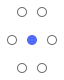
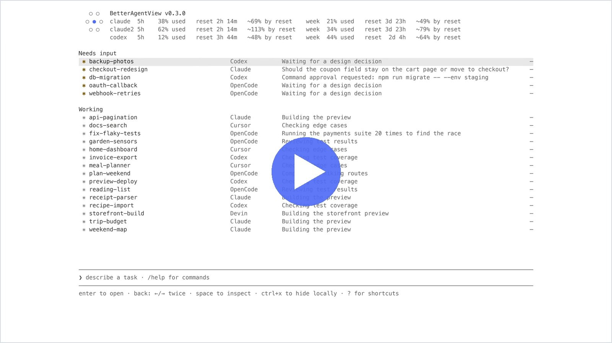
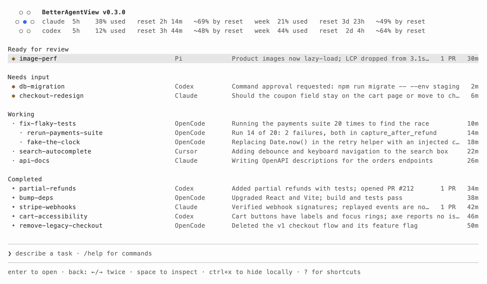

<div align="center">

<h1> BetterAgentView</h1>

**All your coding agents. One terminal.**<br>
See which one needs you. Jump in, jump back out. Works with 18 coding
harnesses and plain shell jobs.

[](docs/testing.md)
[](https://github.com/moritzWa/betteragentview/releases/latest)
[](LICENSE)

<a href="https://betteragentview.com/film.mp4"></a>



</div>

## Install

```console
curl -fsSL https://raw.githubusercontent.com/moritzWa/betteragentview/main/install.sh | bash
```

<details>
<summary>Windows PowerShell</summary>

```powershell
irm https://raw.githubusercontent.com/moritzWa/betteragentview/main/install.ps1 | iex
```

</details>

<details>
<summary>Build from source</summary>

```console
cargo install --locked --git https://github.com/moritzWa/betteragentview
```

</details>

Run `betteragentview`, or the shorter `av` command the installer adds. The old
`agentview` command, configuration paths and environment variables still work.
Type a task,
press `Tab` to pick a harness and `Shift+Tab` to pick a model. `Shift+Tab` also
works from the session list before you type.
`Ctrl+B` keeps the model and switches who serves it, for example OpenCode's
`anthropic/claude-opus-5-5` and `cursor/claude-opus-5-5`; the model you pick is
remembered across restarts.

## Why

Five agents means five terminal tabs, and the one waiting on you is in the tab
you aren't looking at. BetterAgentView lists every session from every harness in one
place, with the ones that need you on top. Selecting a row opens the harness's
own interface.

## Features

### See what needs you

- **Sessions grouped by status**, with the harness on every row. [Completion labels](docs/cli.md#completion-labels)
  distinguish a finished task from a finished project; uncertain sessions stay Idle.
- **Subscription usage at a glance:** Claude and Codex limits, resets, and pace
  in the header. `/usage` shows the full breakdown, including a second Claude subscription on macOS.
- **Builds and tests in line:** an optional [agent-bouncer](https://github.com/moritzWa/agent-bouncer)
  panel shows running jobs, waits, and when the queue should clear.
- **Light and dark themes** follow your terminal and OS, or choose with `--theme`.

### Find and organize sessions

- **Search past chats with `Ctrl+G`**, by name, harness, folder, ID, or message text
  across Claude Code, Codex, and OpenCode. Partial words and snippets help you find
  the right conversation; `Enter` restores it. An empty search shows frequently used sessions first.
- **Keep work and personal chats separate.** [Work-only browsing](#work-only-browsing)
  hides personal sessions without stopping their agents. Toggle back to your previous chat or draft.
- **Pause or schedule:** `Ctrl+T` parks a session in Paused; `/defer` puts it in Scheduled.
  Reminders on active work stay beside its normal status. `/keep` brings a deferred session back.
- **Reorder, hide, undo:** reorder with `Option+↑` / `↓`, stop and hide or delete
  with `Ctrl+X` twice, and undo a hide with `Ctrl+Z` (map `Cmd+Z` in Ghostty).
- **Preview servers don't count as ongoing work.** Mark them as services to keep
  the session's normal status instead of Background.

### Start and switch work

- **Jump into the harness's own interface and back** while work keeps running.
  Background-capable harnesses launch without leaving the dashboard.
  OpenCode sessions outlive it; Cursor chats show live state on every platform.
- **Start in any folder** with `/cd` or `Ctrl+O`. Write multi-line drafts, paste
  long text, attach clipboard images with `Ctrl+V`, and select text with `Shift+arrow`
  or words with `Option+Shift+arrow`.
- **Move or migrate a session:** `F6` changes folders; `/migrate` changes
  harnesses through [session-migrate](https://session-migrate.github.io/).
  OpenCode folder moves preserve the session ID and history.
- **Per-project OpenCode models:** choose `Default` to follow the folder's config
  or plugin rules, or pick a model explicitly to override them.

### Talk to your agents

- **Desktop voice for OpenCode:** `Ctrl+K` or `Cmd+K` lets you ask what needs you,
  hear a session's answer, give it a task, or start a new one. Supports OpenAI's
  GPT-Live and xAI's Grok. [Voice Mode](docs/voice.md).
- **ChatGPT mobile voice:** opt-in OpenCode history search and queued replies
  through a private MCP server, even without the dashboard. Approved output files
  open in ChatGPT's file viewer. [Setup and privacy](docs/mobile-bridge.md).

### Performance

- **Refreshes don't block typing or navigation.** Harnesses refresh in parallel
  on background threads, reading local data directly where possible.
- **Fast local message search:** SQLite FTS5 indices update at startup and every
  30 seconds, reindexing only changed sessions. Harness logs and databases stay read-only.

**No OpenCode fork is needed for fast dashboard refreshes or history search.**
Those optimizations live in BetterAgentView and support stock OpenCode.
Opening a chat is a separate path: reusing one prewarmed OpenCode interface across
sessions needs targeted TUI switching, available in my [OpenCode fork](https://gist.github.com/moritzWa/9c0eb6f5d36a238714a40b900fde09ce).
BetterAgentView detects that capability. Without it, chats still open, but the first
open of each session can take longer because it starts a separate interface.

#### Dashboard refresh

betteragentview is fast because it skips each harness's CLI wherever it can and
reads the data itself: OpenCode's SQLite database directly instead of starting
`opencode db` for every query, and which Cursor chats are open straight from
macOS instead of running `lsof`.

| Harness | Time per refresh |
| --- | ---: |
| OpenCode | ~130 ms |
| Claude Code | ~180 ms |
| OpenAI Codex | ~80 ms |
| Cursor | ~3 ms |
| Devin | ~6 ms |
| Pi, Antigravity, Terminal | under 1 ms |

Median refresh over 30 s on an Apple M5 Pro with a 17 GB OpenCode history,
recorded using my setup. Refreshes read harnesses in parallel, off the input thread.
The direct-database optimization does not need the fork; stock was not separately timed on that history.

#### Chat opening

| Harness | Opening / returning |
| --- | ---: |
| OpenCode | ~204 ms; **~52 ms with [my fork](https://github.com/moritzWa/opencode/tree/v2-parity) (3.9× faster)** |
| Claude Code | ~208 ms |
| OpenAI Codex | ~1.35 s first visit; **~16 ms returning** |
| Cursor | ~1.31 s first visit; **~20 ms returning** |
| Pi | ~159 ms |
| Devin | ~675 ms (Linux Space) |
| Antigravity | Not measured |
| Terminal | ~14 ms to a shell prompt |

Chat-opening medians on the same Apple M5 Pro, restoring 40-message synthetic chats
until the last reply reaches a headless terminal. OpenCode uses a warm server
(40 openings per build); the other measured harnesses start new native processes
after one warm-up (30 openings each). Returning reuses the interface BetterAgentView
already keeps open: **~16 ms for Codex and ~20 ms for Cursor**, measured through the
actual dashboard over 30 returns each. No model response is generated.
Devin uses a separate Linux Space, so its result is not directly comparable to the Mac runs.
Antigravity rejected the fixture, so it gets no timing.
Terminal measures 30 clean-profile zsh starts to a usable prompt, not chat restoration.
[Versions, raw samples, and reproduction](docs/performance.md).

## Work-only browsing

1. Create `~/.config/agentview/work-roots.json` with your work repos' **absolute paths**:

   ```json
   {"roots":["/Users/alex/Code/company-app","/Users/alex/Code/company-site"]}
   ```

2. Restart BetterAgentView after adding or changing the config. Subfolders and linked
   Git worktrees count as work too. Personal sessions disappear from the overview,
   session search and restore picker while work-only browsing is on.
3. Bind `betteragentview view toggle` to a **global shortcut** to switch without focusing
   your terminal. The shortcut isn't built in. See the
   [macOS setup with Karabiner-Elements](docs/work-view.md#global-shortcut-on-macos).

The command switches every running dashboard. Toggle again to return to your
previous chat or overview. Other apps and browser windows stay unchanged.

## Keys

| Do this | Press |
| --- | --- |
| Move through sessions | `↑` / `↓` |
| Jump between folders | `Cmd+↑` / `↓` in kitty, or in Ghostty with `keybind = cmd+up=unbind` and `keybind = cmd+down=unbind` |
| Open the selected session | `Enter` or `→` |
| Return to betteragentview | `F7` from anywhere, or `←` twice at an empty prompt (once in Claude Code and OpenCode). Shift+arrows stay available for text selection. Existing [F13 mappings](docs/cli.md#a-dedicated-key-to-return-to-the-dashboard) also work |
| Bring back a past session | `Ctrl+G` or `/hidden` |
| Rename / filter | `Ctrl+R` / `Ctrl+F` |
| New line in a task | `Shift+Enter`, `Ctrl+J`, or `\` then `Enter` |
| Show every shortcut | `?` |

On Mac keyboards with media keys, hold `Fn` to send `F6` or `F7`.

The [CLI and keyboard guide](docs/cli.md) covers models, login, paging, bulk
actions, non-interactive commands, and [`--yolo`](docs/cli.md#explicit-yolo-mode)
for unattended runs.

## Harnesses

betteragentview brings 18 local coding harnesses plus Terminal into one dashboard: [Claude Code](https://github.com/anthropics/claude-code), [OpenAI Codex](https://github.com/openai/codex), [Pi](https://pi.dev), [OpenCode](https://github.com/anomalyco/opencode), [Cursor](https://cursor.com/cli), [GitHub Copilot](https://github.com/github/copilot-cli), [Antigravity](https://developers.google.com/antigravity), [Mistral Vibe](https://github.com/mistralai/mistral-vibe), [Muse Code](https://dev.meta.ai/), [Qwen Code](https://github.com/QwenLM/qwen-code), [Kimi Code](https://github.com/MoonshotAI/kimi-cli), [Oh My Pi](https://github.com/can1357/oh-my-pi), [Grok](https://github.com/xai-org/grok-build), [Kilo Code](https://github.com/Kilo-Org/kilocode), [OpenHands](https://github.com/OpenHands/OpenHands-CLI), [Hermes Agent](https://github.com/NousResearch/hermes-agent), [MastraCode](https://github.com/mastra-ai/mastra/tree/main/mastracode), [Devin](https://github.com/CognitionAI/devin-cli), [Terminal](docs/cli.md).

### Compare feature support by harness

| Harness | Launch | Model / shell picker | Open / resume | Inspect | Inline reply | Approval / input | Stop | Delete / archive |
| --- | :---: | :---: | :---: | :---: | :---: | :---: | :---: | :---: |
| Claude Code | ✓ | ✓ | ✓ | ✓ | — | — | ✓ | — |
| OpenAI Codex | ✓ | ✓ | ✓ | ✓ | ✓ | ✓ | ✓ | ✓ |
| Pi | ✓ | ✓ | ✓ | ✓ | ✓ | ✓ | ✓ | ✓ |
| OpenCode | ✓ | ✓ | ✓ | ✓ | ✓ | — | ✓ | — |
| Cursor | ✓ | ✓ | ✓ | ✓ | ✓ | — | ✓ | — |
| GitHub Copilot | ✓ | ✓ | ✓ | ✓ | ✓ | ✓ | ✓ | — |
| Antigravity | ✓ | ✓ | ✓ | — | — | — | ✓ | — |
| Mistral Vibe | ✓ | ✓ | ✓ | ✓ | — | — | ✓ | — |
| Muse Code | ✓ | ✓ | ✓ | ✓ | — | — | ✓ | — |
| Qwen Code | ✓ | ✓ | ✓ | ✓ | — | — | ✓ | — |
| Kimi Code | ✓ | ✓ | ✓ | ✓ | — | — | ✓ | — |
| Oh My Pi | ✓ | ✓ | ✓ | ✓ | — | — | ✓ | — |
| Grok | ✓ | ✓ | ✓ | ✓ | — | — | ✓ | — |
| Kilo Code | ✓ | ✓ | ✓ | ✓ | — | — | ✓ | — |
| OpenHands | ✓ | ✓¹ | ✓ | ✓ | — | — | ✓ | — |
| Hermes Agent | ✓² | ✓¹ | ✓² | ✓ | — | — | ✓² | — |
| MastraCode | ✓² | ✓¹ | ✓² | ✓ | — | — | ✓² | — |
| Devin | ✓ | ✓ | ✓ | ✓ | — | — | ✓ | — |
| Terminal | ✓ | ✓ | ✓ | ✓ | — | — | ✓ | ✓ |

A dash means the session still shows up, but that action stays in the
harness's own interface.

¹ Models come from saved sessions or configs; exact model IDs also work.
² Prompt automation needs a Unix terminal.

Versions, auth, and per-harness caveats are in the
[provider notes](docs/exploration/README.md).

betteragentview pairs well with OpenCode. My
[OpenCode setup](https://gist.github.com/moritzWa/9c0eb6f5d36a238714a40b900fde09ce)
adds Cursor models, background shells, worktree tools, and long-running turns
that survive Cursor dropping out.

## Docs

[Install](docs/install.md) · [CLI](docs/cli.md) · [Voice Mode](docs/voice.md) ·
[Troubleshooting](docs/troubleshooting.md) ·
[Architecture](docs/architecture.md) · [Testing](docs/testing.md) ·
[Contributing](CONTRIBUTING.md) · [Security](SECURITY.md)

## License

[MIT](LICENSE). Not affiliated with any of the harnesses listed above.
